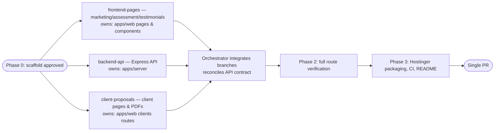

# Refactor bosch-technologies into a Node/React monorepo
## Problem statement
`bosch-technologies` is currently a dependency-free static PHP/HTML/JS site, deployed by uploading files directly to Hostinger shared hosting. The goal is to restructure it the same way `/Users/garthbosch/projects/tamiabosch` was restructured — an npm-workspace monorepo with a modern frontend build — so the repo can become **private** and be deployed as a genuine Node.js **Web App** on Hostinger instead of raw PHP/HTML, giving more deployment control.
Unlike tamiabosch (zero backend — its contact form is simulated client-side), this site has real server logic that must be preserved: email-sending forms, a testimonial admin CRUD API, server-side PDF conversion, and per-client PHP-session password gates. Per your decisions, this refactor replaces PHP entirely with a Node/Express backend (a true Node "Web App", not a static-only Custom PHP/HTML site like tamiabosch's), and includes the client proposal pages in scope.
## Current state
Key facts gathered from the existing code (see `README.md`, `api/*.php`, `js/*.js`, `clients/*/*.php`):
* **Marketing pages** (pure HTML/CSS/vanilla JS, no backend coupling beyond form POSTs): `index.html`, `services/*.html` (×3), `portfolio/index.html`, `maturity-model/index.html`, `contact/index.html`.
* **Assessment tool** (`assessment/index.html` + `js/assessment-questions.js` + `js/assessment.js`): 20-question flow, client-side scoring, Chart.js radar chart, jsPDF export, posts the lead to `api/submit-assessment.php`.
* **Testimonials** (`testimonials/index.html`): public approved-only list fetched from `data/testimonials.json`, plus a submission form (name/role/company/testimonial/logo/reference-letter) posted to `api/submit-assessment.php` with `form_type=testimonial`.
* **3 PHP API endpoints** (`api/`):
    * `submit-assessment.php` — single endpoint branching on `form_type` (`assessment` | `contact` | `testimonial`); sanitises input, sends HTML email via `mail()`, appends to `data/leads.csv`; for testimonials also handles file uploads (reference letter → converted to PDF, logo saved as-is) and appends to `data/testimonials.json` with `approved: false`.
    * `convert-to-pdf.php` — converts uploaded reference letters to PDF using vendored FPDF (`api/lib/`); PDFs pass through, images wrapped in a page, TXT/DOCX text re-rendered.
    * `manage-testimonial.php` — admin CRUD (`list`, `approve`, `reject`, `delete`, `set-logo`, `set-reference`) over `data/testimonials.json`, gated by a secret key in a URL query parameter.
* **Client proposal pages** (`clients/`), each a standalone PHP file with a hardcoded `$access_code`, gated by a PHP session: `weconnectu/` (5 pages: assessment report, maturity results, 2 improvement-engagement proposals, a Word/PDF service-agreement generator), `comotion/` (4 pages: assessment report, 2 maturity-results pages, 1 improvement-engagement proposal), `toomuchiwifi/` (1 proposal page). All PDF/DOCX generation is **already 100% client-side** (jsPDF, and `docx`-library for the WeConnectU Word export) — framework-agnostic and portable as-is.
* **Design system**: a single global `css/styles.css` (dark theme, gold accent `#b8961c`), no per-page stylesheets.
* **Known security debt** (documented in the current README): the admin key, all 3 client access codes, and the notification recipient email are plain-text literals committed to tracked PHP files; the admin key travels as a URL query parameter; `data/leads.csv` sits inside the web root.
## Target architecture (mirrors tamiabosch's refactor pattern)
npm-workspaces monorepo, same root conventions as tamiabosch (`.nvmrc`, root `package.json` with `workspaces: ["apps/*"]`, shared ESLint/Prettier, Vitest, GitHub Actions CI):
* **`apps/web`** — React 18 + React Router 7 + Vite + Tailwind CSS + Radix UI primitives (shadcn/ui pattern: `clsx` + `tailwind-merge` + `class-variance-authority`) + Lucide icons + `react-hook-form` + `recharts` (replaces Chart.js for the radar chart) + `sonner` (toast notifications) + `react-helmet` (per-page `<title>`/`noindex`) + Vitest/React Testing Library, mirroring tamiabosch's dependency choices. The existing `css/styles.css` design system is kept as a global stylesheet import rather than rewritten into Tailwind utilities, to avoid visual regressions across ~20 pages; Tailwind is available for new interactive pieces (forms, admin views) alongside it.
* **`apps/server`** — Node + Express, providing functional parity with the 3 PHP endpoints plus new auth endpoints:
    * `nodemailer` for email (SMTP credentials via environment variables, matching Hostinger-provided SMTP).
    * Signed, HTTP-only cookie sessions (`express-session` or equivalent) for client-proposal gating and the testimonial admin, replacing PHP sessions. Every secret (admin key, each client's access code, SMTP creds, recipient email) moves to environment variables / `.env.example` — none stay hardcoded in source, directly fixing the security debt called out in the current README.
    * `multer` for file uploads (reference letters, logos).
    * `pdf-lib` for PDF conversion (replacing vendored FPDF) and `mammoth` for DOCX text extraction.
    * JSON/CSV persistence kept conceptually the same (`data/testimonials.json`, `data/leads.csv`) but moved outside `apps/web`'s build output so it is never web-servable directly, only read/written by the server process.
* **Client proposal routes**: `/clients/:slug/*` React routes calling the new session-gated API; existing jsPDF/`docx` generator functions ported into shared utility modules under `apps/web/src/lib/` largely unchanged.
* **Hostinger packaging**: a new `scripts/package-hostinger.mjs`, analogous to tamiabosch's but for a Node app — assembles `apps/server` source + `apps/web` build output + `package.json`/lock (excluding `node_modules`, which Hostinger installs server-side) into a release folder/archive for upload, since Hostinger's Node.js hosting runs `npm install` + a startup script rather than serving pre-built static files only. `README.md` gets an equivalent "Production deployment on Hostinger" section documenting the Node **Web App** hPanel flow (as opposed to tamiabosch's Custom PHP/HTML flow) — the actual hPanel operations remain yours to perform, per your note that you'll do the Hostinger-side move yourself.
* **CI**: GitHub Actions workflow mirroring tamiabosch's — install, lint, test with coverage, build both apps, package. Given this is a from-scratch test suite (unlike tamiabosch's already-mature one), the initial coverage gate is set lower (e.g. 60%) with a note in the README that it can be raised once coverage grows, rather than claiming tamiabosch's 90% threshold from day one.
## Migration map
Old path → new location:
* `index.html`, `services/*.html`, `portfolio/index.html`, `maturity-model/index.html`, `contact/index.html` → `apps/web/src/pages/*` (React Router routes), reusing `css/styles.css` globally.
* `assessment/index.html` + `js/assessment-questions.js` + `js/assessment.js` → `apps/web/src/pages/Assessment.jsx` + `apps/web/src/lib/assessment-data.js` (questions/levels/recommendations) + a `recharts`-based radar chart component; PDF export logic ported to a `apps/web/src/lib/pdf/assessment-report.js` utility.
* `testimonials/index.html` → `apps/web/src/pages/Testimonials.jsx` (public list + submission form via `react-hook-form`) + `apps/web/src/pages/admin/Testimonials.jsx` (session-gated admin view replacing the raw query-string API calls).
* `api/submit-assessment.php` → `apps/server/src/routes/contact.js`, `apps/server/src/routes/assessment.js`, `apps/server/src/routes/testimonials.js` (split by concern instead of one branching file).
* `api/convert-to-pdf.php` + `api/lib/` (FPDF) → `apps/server/src/lib/convert-to-pdf.js` (pdf-lib + mammoth).
* `api/manage-testimonial.php` → `apps/server/src/routes/admin-testimonials.js`, session-cookie gated instead of a URL query key.
* `clients/weconnectu/*.php`, `clients/comotion/*.php`, `clients/toomuchiwifi/index.php` → `apps/web/src/pages/clients/<slug>/*.jsx` + `apps/server/src/routes/client-auth.js` (unlock/session endpoints, one access code per slug from env vars); each page's embedded PDF/DOCX generator moves to `apps/web/src/lib/pdf/clients/<slug>-*.js` unchanged in content.
* `data/testimonials.json`, `data/leads.csv` → unchanged format, relocated to a server-only data directory outside `apps/web`.
## Orchestration
* **Decision**: Yes — after the Phase 0 scaffold lands and is reviewed, the three largely-independent Phase 1 tracks (frontend marketing/assessment/testimonials, backend API, client-proposal migration) run as separate local child agents to parallelise the bulk of the mechanical page-by-page and endpoint-by-endpoint porting.
* **Dependencies and ordering**: Phase 0 (scaffold) must land and be merged into the working branch before Phase 1 children start, since all three tracks depend on the shared monorepo layout, Tailwind/CSS setup, and Express skeleton it creates. Phase 1's three tracks are mutually independent during development (frontend tracks can stub the API contract; the backend track builds against the same contract) and fan back in at Phase 2 for integration. Phase 2 (wire real API, full route-by-route verification) and Phase 3 (Hostinger packaging script, CI, README, removal of superseded PHP/HTML) happen after Phase 1 merges, in that order. Validation (lint/test/build) happens before any PR is opened.
* **Launch config**: All three Phase 1 children run **locally**, each in its own git worktree/branch off the Phase-0 scaffold branch, using the orchestrator's current model/harness (no override needed) — see the attached orchestration config.
* **Child agents**:
    * **frontend-pages** — owns `apps/web/src/pages/{Home,Services,Portfolio,MaturityModel,Contact,Assessment,Testimonials}.jsx` and shared `Header`/`Footer`/`Layout` components, porting the marketing pages and the assessment tool (radar chart via `recharts`, scoring logic, PDF export) and the public testimonials page/submission form. Runs in local worktree `../bosch-technologies-frontend-pages` on branch `refactor/frontend-pages`, stubbing API calls against the documented contract until Track backend lands. Validates with `npm run lint` and component/integration tests for the assessment scoring and testimonial form. Hands back a branch + summary of any contract assumptions for the orchestrator to reconcile with the backend track.
    * **backend-api** — owns `apps/server` entirely: Express app skeleton, `contact`/`assessment`/`testimonials`/`admin-testimonials`/`client-auth` routes, `nodemailer`, `multer`, `pdf-lib`/`mammoth` conversion, env-var config, and CSV/JSON persistence. Runs in local worktree `../bosch-technologies-backend-api` on branch `refactor/backend-api`. Validates with endpoint tests (supertest or equivalent) covering each route's success/validation-error paths. Hands back a branch + the finalized API contract (routes, payloads, cookies) for the frontend/clients tracks to integrate against.
    * **client-proposals** — owns `apps/web/src/pages/clients/**` for all three clients (weconnectu, comotion, toomuchiwifi) and their ported PDF/DOCX generator utilities, plus consumes the `client-auth` contract from backend-api (stubbed until merged). Runs in local worktree `../bosch-technologies-client-proposals` on branch `refactor/client-proposals`. Validates by rendering each proposal route headlessly and regenerating every PDF/DOCX to confirm byte-for-byte-equivalent content to the current PHP output (reusing the Puppeteer + pdfjs/mammoth verification approach already used earlier for these same pages). Hands back a branch + a checklist confirming each client page's content and downloads match.
* **Merge strategy**: The orchestrator integrates all three branches into one integration branch after each child reports completion, resolving any API-contract mismatches between `backend-api` and the two consumers, then performs Phase 2 end-to-end verification itself before opening a single PR for the whole refactor (keeping review manageable as one coherent change rather than three partial ones).
* **Diagram**:

## Phased plan
1. **Phase 0 — Scaffold** (orchestrator, no children): root `package.json` workspaces, `.nvmrc`, ESLint/Prettier config, `apps/web` Vite+Tailwind+Radix skeleton with shared `Header`/`Footer`/`Layout` reusing `css/styles.css`, `apps/server` Express skeleton with a health-check route and env-var loading. This becomes the branch point for Phase 1's children.
2. **Phase 1 — Parallel migration** (3 child agents as above): marketing/assessment/testimonials frontend, Express backend, client-proposal pages.
3. **Phase 2 — Integration & verification** (orchestrator): merge the three branches, wire real API calls everywhere (replacing any frontend stubs), then run a full route-by-route headless-browser pass (every marketing page, the assessment flow end-to-end, testimonial submission + admin approve/reject, every client proposal page including login gate, and every PDF/DOCX download) the same way prior verification in this project has been done.
4. **Phase 3 — Packaging, CI, docs, cleanup** (orchestrator): `scripts/package-hostinger.mjs` for the Node app, `.github/workflows/ci.yml`, rewritten `README.md` (stack, structure, API reference, Hostinger Web App deployment steps, updated security notes confirming secrets now live in env vars), and removal of the superseded PHP/HTML/vanilla-JS files once the new app has full parity (git history retains them, so this is a clean deletion, confirmed with you before it happens).
5. **Phase 4 — Final review**: full `npm run lint && npm run test:coverage && npm run build` from the repo root, manual smoke pass, open one PR for the whole refactor.
## Assumptions to confirm during plan review
* Coverage gate starts at a lower bar (e.g. 60%) instead of tamiabosch's 90%, since this is a new test suite; raising it later is a follow-up, not blocking this refactor.
* The exact Hostinger Node.js hPanel click-path (startup file name, Node version selector, env-var entry) can't be verified without an active hPanel session; the plan documents the general Node "Web App" flow and leaves the actual account-level setup to you, consistent with you handling the Hostinger-side move yourself.
* Old PHP/static files are deleted (not archived) once the new app reaches parity in Phase 3 — flag if you'd prefer to keep them around longer.
## Current status (2026-11-08)
All 5 phases above are complete and merged to `main` (PRs #6, #7, #8, #9; Phase 2/3 work and the legacy-file deletion committed directly to `main` per the established pattern after the Phase 1 self-merge deviation).
Legacy PHP/HTML/vanilla-JS files are fully deleted from the repo (`index.html`, `services/`, `portfolio/`, `maturity-model/`, `testimonials/`, `contact/`, `assessment/`, `clients/`, `api/`, `css/`, `js/`, `assets/`, `data/`). `apps/server/seed/testimonials.json` preserves the real approved testimonial content, and `client-document-parity.test.js`/`client-pages.test.jsx` now assert against frozen fixtures instead of the deleted legacy source.
After the first production deploy, visual comparison against the still-live old static site (darksalmon-dugong-440006.hostingersite.com) surfaced 3 separate CSS cascade-order bugs, all fixed and pushed to `main`:
1. `--primary`/`--accent` CSS variable name collision between `legacy.css` (hex colors) and the shadcn `:root` block in `index.css` (bare HSL triplets) — fixed by renaming the shadcn variables to `--shadcn-primary`/`--shadcn-accent` (commit `9159f89`).
2. Tailwind preflight (`@tailwind base`) silently overriding legacy's `h1-h6`/`body`/`a` element-selector rules (equal specificity, later source order since `@import` must stay first) — fixed by reasserting legacy's exact values after `@tailwind utilities` in `index.css` (commit `7ba20dc`).
3. Tailwind's built-in `container` core plugin emitting a competing, wider `.container` class that overrode legacy.css's own — fixed via `corePlugins.container = false` in `tailwind.config.js` (commit `9a86457`).
## Hostinger fix (2026-11-08)
* **Root cause of the 404s:** Hostinger's Git auto-deploy was building the repo as a static `app_type: other` app (no entry file, "Mode: publish"), copying `dist/apps/web` into `public_html`. Express never ran, so LiteSpeed served `/index.html` for `/` and its own stale 404 for everything else. There was no leftover `.htaccess`, and the "legacy directories" (`testimonials/`, `images/`, `assets/`) were really `apps/web/public` content from the build.
* **Fix:** build settings switched to `app_type: express`, entry `apps/server/src/index.js` (Node 22, `npm run build`). Commit `2d6e1a6` lets the server find `<repo>/dist/apps/web` when there's no packaged `web/`, disables `express.static` directory redirects, and seeds `DATA_DIR/testimonials.json` from `apps/server/seed/` on first start.
* **Env vars on Hostinger:** `TRUST_PROXY=1`, `SITE_URL`, `DATA_DIR=/home/u705970909/domains/boschtechnologies.com/data` (persistent, outside the `hbuilds/versions/*` release folders), `SESSION_SECRET`. Hostinger sets `NODE_ENV=production` itself.
* **Verified live:** `/`, `/assessment`, `/testimonials`, `/portfolio`, `/clients/weconnectu`, unknown paths → SPA (200); `/api/health`, `/api/testimonials` (2 seeded testimonials); client unlock with a wrong code returns 401; static images/PDF served; testimonials page renders correctly in a real browser.

## Outstanding
* **Remaining secrets not yet on Hostinger:** `ADMIN_SESSION_SECRET`, `CLIENT_ACCESS_CODE_{WECONNECTU,COMOTION,TOOMUCHIWIFI}` (old codes recovered from git history), and SMTP (`SMTP_HOST/PORT/USER/PASSWORD`, `NOTIFICATION_EMAIL`). All are staged in the gitignored `apps/server/.env`, SMTP still blank. Until they're added, client unlock always fails, the admin view can't log in, and form submissions return an email error.
* After the secrets are in place: verify client unlock + PDF/DOCX downloads, admin approve/reject, and one real form submission end to end.
* Pre-existing, unrelated: 2 failing web tests in `client-document-parity.test.js` (weconnectu/toomuchiwifi `generateProposalPDF` fixture drift), already failing on `main` before this work.
